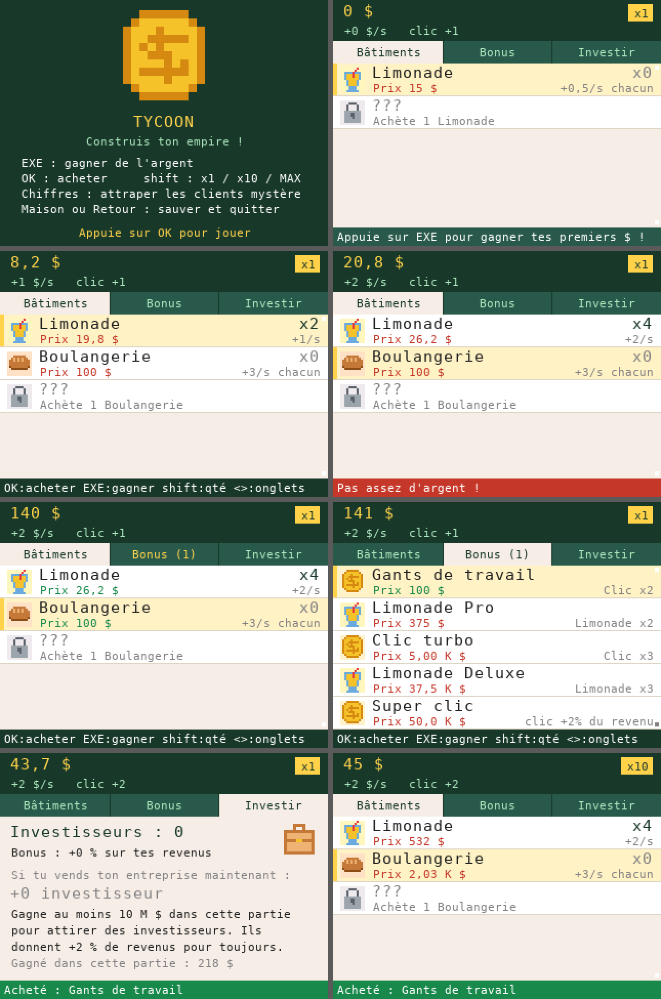

# Tycoon pour NumWorks

Un jeu de gestion pour la calculatrice graphique **NumWorks** : commence avec un stand de limonade et construis un empire jusqu'à une base sur Mars.

**[⬇ Télécharger Tycoon.nwa](https://github.com/Rayvorr/numworks-tycoon/raw/main/Tycoon.nwa)**



## Le jeu

- **9 bâtiments** qui rapportent de l'argent tout seuls : Limonade, Boulangerie, Pizzeria, Cinéma, Usine, Banque, Studio jeux, Fusée et Base martienne. Chacun débloque le suivant.
- **Paliers** : à 25, 50, 100, 200… exemplaires d'un bâtiment, ses revenus doublent.
- **36 bonus** à acheter, pour un bâtiment, pour ton clic ou pour tous tes revenus.
- **Clients mystère** : de temps en temps, appuie vite sur le chiffre affiché pour gagner un paquet d'argent ou un **RUSH x5** de 20 secondes.
- **Investisseurs** : dès 10 M $ gagnés, vends ton entreprise. Tu repars de zéro, mais chaque investisseur te donne +2 % de revenus pour toujours.
- **Sauvegarde automatique** toutes les 20 secondes et en quittant (fichier `tycoon.sav`).

## Les touches

| Touche | Action |
|---|---|
| EXE | Gagner de l'argent |
| OK | Acheter |
| Haut / Bas | Choisir |
| Gauche / Droite | Changer d'onglet |
| shift | Acheter x1 / x10 / MAX |
| 1 à 9 | Attraper un client mystère |
| Maison ou Retour | Sauvegarder et quitter |

## Installer

1. Télécharge **[Tycoon.nwa](https://github.com/Rayvorr/numworks-tycoon/raw/main/Tycoon.nwa)**.
2. Branche ta calculatrice à l'ordinateur et allume-la.
3. Va sur [my.numworks.com/apps](https://my.numworks.com/apps) avec **Chrome** ou **Edge** et connecte-toi.
4. Clique sur **Connect**, choisis ta calculatrice, ajoute `Tycoon.nwa`, puis clique sur **Install**.
5. Sur la calculatrice, appuie sur la touche Maison : Tycoon est à la fin des applis.

> Installer des applis **remplace celles déjà installées** : pour en garder d'autres, ajoute-les en même temps. Réinstaller des applis ou faire un reset efface aussi la sauvegarde.

Il faut une NumWorks N0110, N0115 ou N0120 avec Epsilon 23.2 ou plus récent.

## Compiler soi-même

Il faut le compilateur `arm-none-eabi-gcc` (avec newlib) et Node.js.

```sh
make        # crée output/Tycoon.nwa
make host   # version PC pour les tests (output/tycoon_host)
```

`fixnav.js` contourne un souci de `nwlink` avec Node.js 22 ou plus récent.

### Tester sur PC

La version PC imite la calculatrice : les touches viennent d'un script, et chaque dessin est enregistré puis transformé en images avec `host/render.py` (il faut Pillow).

```sh
make host
TYCOON_SCRIPT=test/script1.txt TYCOON_OPS=ops.txt TYCOON_FS=fs.bin ./output/tycoon_host
mkdir -p shots && python3 host/render.py ops.txt shots
```

`test/balance.py` simule un joueur pour vérifier le rythme du jeu.

## Crédits

- `src/epsilon_app.h` et `src/epsilon_files.h` viennent de [NumPlay](https://github.com/Mason363/NumPlay) par Mason Chen (GPL-3.0). Ils gèrent la sauvegarde et la touche Maison sans danger pour la calculatrice. `epsilon_app.h` a été légèrement modifié pour la version PC.
- Le `Makefile` part de l'[appli d'exemple en C](https://github.com/numworks/epsilon-sample-app-c) de NumWorks (licence BSD).
- Le SDK [nwlink](https://www.npmjs.com/package/nwlink) de NumWorks.

Projet de fan, non affilié à NumWorks. NumWorks est une marque déposée.

## Licence

[GNU GPL v3.0](LICENSE)
